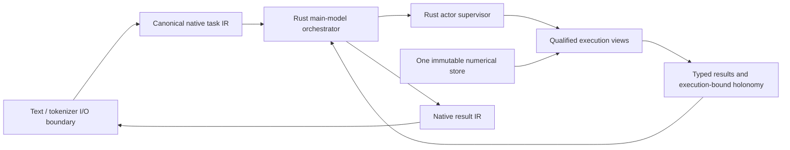

# Atoma Engineering Brigade: Carved Swarm Design, Preregistration, and Evidence Audit

**Product:** a stand-alone Atoma Engineering.app containing the Atoma Engineering Brigade, for the accepted Meta Hackathon build sprint (acceptance and stand-alone requirement reported by the user on 2026-10-20). **Build start:** October 26, 2026. Until then, authorized work is limited to design, preregistration, proofs, audits, and planning paperwork; do not start application implementation before the build window. **Status:** planning/proof phase; no implementation change authorized. **Scope:** define how the Brigade can carve hyper-specialists from one immutable model-weight set, run them under an active main-model orchestrator, and prove the resulting system works without prompt wrappers. **Protocol version:** CS-PR-01, 2026-10-20. Thresholds below are preregistered and may not be relaxed after results.

**Product boundary:** this is a new stand-alone app; it is not a feature or integration inside Model Home or Elle. Those repositories may be inspected as read-only design/evidence references where useful. `/Users/stewartbarteau/Desktop/monster-hybrid-server` supplies reference architecture and carve evidence; it is not the product repo. No product-source repository has been designated, and none is needed for this pre-build planning phase.

**Binding runtime requirement (user clarification, 2026-10-20):** the product is Rust-based throughout, uses native MLIR internally, and confines text/tokenization to the I/O boundary. Erlang/OTP describes controller semantics, implemented in Rust. The legacy checkpoint/token experiments below are external controls for carving mechanisms, not the product execution architecture. §14 governs native runtime qualification.

## 1. Decision and current evidence

The repo contains a geometric memory/silo carving path, policy and compliance types, and a Rust `Governor` simulation. `specialist_carving.rs` derives task profiles from map evidence; `silo.rs` makes role-filtered memory views; `orchestrator/src/swarm/mod.rs` models role lifecycle and restart behavior. These are implementation artifacts, not proof of learned hyper-specialization or effective autonomous specialists.

The current `spawn_swarm` creates role processes and workers, but worker state is newly allocated per role. The inspected swarm module does not establish that each worker loads and executes the same model weights, that carved role views alter model computation, or that the main model actively delegates/reclaims control in an end-to-end product run. Existing `docs/swarm-phase0-prereg.md` is a separate prompt/preamble and tool-subset sub-agent experiment; it does not qualify weight carving. Treat claims in `design/CARVED_SWARM_SPEC.md` about physically isolated inference, unforgeable handoffs, OTP supervision, or 12 proven hyper-specialists as **unverified until demonstrated by source-level and runtime evidence**.

**Non-goal:** prompt text, system-message wrappers, role preambles, tool descriptions, or task instructions may not create the specialization. They are excluded from treatment arms and acceptance evidence. Routing metadata may identify an expert, but must not add model-visible instruction tokens.

## 2. Operational definition and hypotheses

A **hyper-specialist** is a runtime expert derived from one immutable weight artifact whose constrained computational pathway measurably improves a preregistered domain task set over the uncarved base model, while preserving base-model fallback. Carving may select/route existing tensors, heads, layers, channels, activations, or memory/KV regions; it may not fine-tune, add adapters, distill new weights, or alter weights. The actual mechanism must be specified and fingerprinted before qualification.

**H1:** Each carved expert improves its assigned domain score by ≥10 absolute percentage points and has a 95% paired-bootstrap CI lower bound >0 versus base. **H2:** non-assigned domain performance decreases by no more than 2 points. **H3:** orchestrated system matches or exceeds base on aggregate and never accepts an expert result that fails verifier/authorization checks. **H4:** every expert references the same base-weight SHA-256; runtime weight bytes are immutable. **H5:** removing all model-visible role wrappers leaves behavior and routing unchanged within deterministic replay tolerance.

## 3. Preregistered protocol

Freeze source commit, model/tokenizer/config fingerprints, hardware/runtime, carving algorithm and parameters, datasets/splits, scoring code, seeds, and orchestration policy in a signed manifest before evaluation. Separate train/calibration, development, and sealed test sets by source and near-duplicate checks. No test examples enter carving, routing thresholds, or prompt construction.

Arms: (A) base model; (B) carved expert alone; (C) main-model orchestrator with experts; (D) sham carve with equal compute/memory budget and random matched selection. Use identical model-visible input bytes across arms; record and hash them. Minimum 500 sealed examples per domain, ≥4 domains, 3 fixed seeds; paired bootstrap by example, 10,000 resamples. Report all examples, failures, abstentions, latency, tokens, memory, and confidence intervals.

The orchestrator remains the authority: it may dispatch only through typed capability grants, bounded budgets, and policy checks; experts cannot invoke peers or expand scope. Every dispatch/result carries task ID, model/config hash, expert-carve hash, input hash, capability set, budget, timestamps, and output hash. Main model must independently validate evidence and choose accept/reject/abstain. Timeout, crash, malformed output, stale manifest, or verifier failure returns control to the main model with an explicit failure state. No silent retries or result substitution.

## 4. Proof obligations and gates

1. **Single-weight provenance:** all workers resolve one immutable artifact digest; startup and periodic checks match; mutation test is rejected.
2. **Carve correctness:** deterministic reconstruction from manifest; selected tensor/activation indices are within bounds; excluded regions are inaccessible; sham control distinguishes specialization from extra compute.
3. **No-wrapper test:** byte-identical model-visible inputs and no role-specific preamble/template; audit serialized requests and transport traces. Any wrapper-dependent gain fails H5.
4. **Causal efficacy:** H1/H2 pass on sealed data with multiplicity correction across domains; publish paired deltas and CIs. No post-hoc subgroup exclusions.
5. **Orchestrator safety:** capability escalation, cross-expert access, replay, stale result, budget exhaustion, timeout, crash, and malicious-output cases all fail closed; main-model authority is preserved.
6. **System utility:** C beats A on aggregate utility with 95% CI lower bound >0, including latency/cost penalty fixed before run; otherwise no promotion.
7. **Reproducibility:** independent clean run reproduces all gates from manifest and artifacts.

Any failed gate blocks promotion. A harness fault may be repaired only if sealed labels remain hidden and the preregistered protocol is rerun in full; disclose deviations. No threshold changes after unblinding.

## 5. Atoma Engineering Brigade integration contract

Atoma Engineering.app exposes an auditable lifecycle: `proposed → carved → qualified → enabled → suspended/revoked`. Only `qualified` experts can be dispatched. The UI/API displays expert identity and carve fingerprint, domain scope, evidence status, active budgets, and audit trail. The Ops board is the engineering-team control surface: the main model assigns roles from the task's defined needs, observes per-agent telemetry, and can nudge, pause, kill, or revise the live iteration path through the typed protocol in §10. Main-model orchestrator owns task decomposition, dispatch, cancellation, synthesis, and final response. Expert outputs are evidence-bearing proposals, never privileged instructions. Revocation invalidates grants and queued work immediately.

## 6. Known gaps and next design decisions

Before implementation, identify Atoma.app’s owning repo and current dispatch/runtime path; define the actual weight-sharing/carving mechanism and model boundary; replace role-name assumptions with measured domain profiles; specify verifier and utility function; pin sealed datasets and threat model. Current repo artifacts support memory-view carving and a simulated supervisor, but do not yet prove the requested model-weight specialists or active orchestrator loop. No code change is included in this preregistration.

## References

- `design/DESIGN.md` (master target architecture and caveats)
- `design/CARVED_SWARM_SPEC.md` (existing proposed architecture; claims require requalification)
- `design/QUALIFICATION_GATES.md` (existing gates; not sufficient for specialization efficacy)
- `immune_system/implementation/src/specialist_carving.rs`, `silo.rs`, `compliance.rs`
- `orchestrator/src/swarm/mod.rs`
- `../Model Home/docs/swarm-phase0-prereg.md` (prompt/preamble experiment; explicitly not evidence for this design)
- `design/DOCUMENTATION_STD.md`

## 7. Prior ELLE / CARVE evidence audit (2026-10-20)

This section adds prior evidence without changing CS-PR-01's prospective gates. It supersedes the earlier statement that no computation-carve mechanism had been investigated.

**Observed mechanism:** CARVE_NATIVE_001 defines a view as the same checkpoint with selected transformer layers skipped while residual state passes through. Candidate generation ranks single-layer removal by teacher-forced KL, then builds nested layer-drop views; it does not train weights, add adapters, or establish domain-specific experts. The ELLE candidate file points every tag to one Qwen3.8-27B-4bit repo and varies the layer list. This supports shared *source artifact* provenance, but does not by itself prove a single in-memory weight allocation across concurrent specialists.

**Native measurement path:** `carveshim.cpp` wraps MLX arrays through a private C ABI, constructs arrays from copied byte buffers, computes final norm/lm-head logits, and compares chunked logits with KL/top-1. Its header explicitly says these opaque handles do not interoperate with qrt-mlx pointers. This is a measurement shim, not the layer-skip execution engine or a swarm/orchestrator. Object-file presence alone does not prove runtime use or concurrency/memory sharing.

**Preregistered screening result:** CARVE's `PREREG.md` fixed 8,192 teacher-forced public text tokens, thresholds, candidate families, and random nulls before scoring. `VERDICT.md` reports all built k=8/12/16/20/24 views **NOT USABLE**. Best built_k8: KL 0.478028 nats/token, top-1 agreement 0.8149; it beats the null KL minimum but misses both usability thresholds (KL ≤0.10, top-1 ≥0.90). Built k12: 1.292764 / 0.6466; k16: 1.537420 / 0.6027; k20: 2.611787 / 0.4681; k24: 5.472019 / 0.2606. Of 48 single linear-layer drops, 31 passed the looser per-view “usable” bar and 17 failed; none were near-lossless. Single-layer removability is not evidence of specialist uplift.

**ELLE task probes (small, exploratory):** the Sept 7 20-item probe recorded full model 14/20 GSM8K, k8 0/20, and k12–k48 mostly 0/20 (k48 0/20); faster generation accompanied severe answer loss. A separate Sept 7 10-item validation recorded full 5/10, k8 7/10, k12 5/10, k16 1/10, k20/k24/k32 0/10. That k8 result is a small noisy signal, not confirmation: the samples/runs differ, there are no paired confidence intervals or repeated seeds, and the preregistered native teacher-forced gate rejected built_k8. Also, the probe scripts contain model-visible system/user instructions; they cannot satisfy the no-wrapper gate and are not evidence for wrapper-free specialization.

**Recomputed held-token evidence:** `CARVE_RECOMPUTED.tsv` marks every multi-layer `built_k*` row NOT USABLE; built_k8 is KL 0.4780/top-1 0.8149, consistent with the verdict. Some isolated single-layer drops meet the looser usable bar, but no role/domain mapping or held-out task benefit is shown. The specified random-null comparison is useful protection against cherry-picking, though threshold success was not achieved.

**Audit disposition:** prior CARVE establishes a real, adapter-free layer-skipping experiment over one checkpoint and a useful null-controlled measurement design. It does **not** establish hyper-specialists, domain separation, active orchestration, shared in-memory weights, or useful carve quality under the preregistered thresholds. Do not promote the k8/k12/etc. views as specialists. Preserve single-layer candidates only as exploratory hypotheses, and do not infer “cheap layers” from one small sum set or low single-drop KL alone.

**Next iteration:** keep the original CARVE preregistration as historical evidence; register a new protocol amendment before any new run. First test whether a full-depth shared trunk plus *small disjoint execution choices* can produce domain-specific gains (e.g., per-specialist routing among individually removable blocks or heads) against full-model and random matched controls. Selection must be learned/derived on training/calibration data, frozen before sealed evaluation, and measured on paired domain and non-domain tasks. Run the chosen expert and main orchestrator without role prompts or preambles; routing may consume non-linguistic task metadata only if that input is preregistered and identical across controls. Explicitly measure model-weight residency, per-expert incremental memory, latency, and concurrent serving. Failed candidates trigger diagnosis and another prospectively registered search cycle under §12. Preserve the objective of useful computational specialists; never promote failed candidates or substitute a reduced product claim for completing the research.

**Evidence paths:** ELLE `research/seam-wire/runs/carve_candidates.json`, `carve_depth_probe.json`, `carve_validate.json`; CARVE `PREREG.md`, `VERDICT.md`, `stage1_results/raw.tsv`; OP-X004 `CARVE_RECOMPUTED.tsv`; `native/cshim/carveshim.cpp/.h`. These are external audit inputs and are not instructions to execute their scripts.

## 8. CARVE-SWARM preregistration CS-PR-02

This is the next experiment contract. It does not authorize implementation or a run. Register the complete manifest, candidate masks, executable hashes, and sealed-data hashes before unblinding. CS-PR-01's historical thresholds and CARVE_NATIVE_001 results remain immutable; this protocol does not relabel them.

### 8.1 Exact treatment and hypotheses

**Treatment:** one checkpoint, one tokenizer/config, one loaded weight store, and a per-request immutable layer-execution mask. A masked transformer block is bypassed by the declared residual identity path. No tensor is edited, fine-tuned, distilled, quantized differently, or copied into a role-specific checkpoint. Each specialist is a *view* over the same weight digest plus a small mask and isolated request state. A domain expert exists only if its frozen mask yields a domain-specific task improvement; names, geometric basins, low ablation KL, and faster decoding do not establish expertise.

Test three separate claims: (P) same weight bytes are shared in memory; (Q) masks cause useful domain specialization; (O) the main-model orchestrator selects and safely uses those specialists. Passing P does not imply Q or O. No combined “swarm success” claim unless all three pass.

### 8.2 Freeze and data custody

Before any new model score: record git commit and dirty-tree patch hash; model, tokenizer, configuration, runtime and compiler versions; weight-file SHA-256/Merkle manifest; mask implementation hash; prompt/tokenizer serialization; hardware and memory telemetry method; task suite, labels, split, scorer, seeds, and analysis script hashes. Name one custodian for sealed labels. Public/previously used examples, GSM8K rows 300–319, the 8,192-token CARVE corpus, and any CARVE screening prompt are development/history only and excluded from confirmatory test.

Use 3 preregistered domains with objectively scored tasks and ≥500 sealed examples per domain from ≥2 independent sources; include ≥500 sealed non-target regression examples per domain (≥1,500 total). Deduplicate by source IDs and normalized near-duplicate matching before splitting. Partition by source/template into calibration 40%, development 20%, sealed test 40%. The test custodian withholds examples and labels from mask search, threshold selection, routing, and debugging. Three fixed decode seeds per example; deterministic settings otherwise. Publish all exclusions before scoring, with reasons.

### 8.3 Candidate generation without leakage

1. Re-run identity path first: full mask through the exact view code must match the established base logits within numerical tolerance and produce identical greedy tokens on the frozen identity suite. Any unexplained mismatch stops the run.
2. On calibration only, measure every eligible single-block skip using teacher-forced KL, top-1 agreement, and domain task scores. Preserve all raw rows. Do not treat low KL as domain expertise.
3. Construct per-domain candidate masks from combinations of individually safe blocks, with a fixed maximum of 8 skipped blocks per view. Candidate search budget: at most 200 masks/domain, deterministic seeded search, chosen and frozen using calibration only. Every domain gets equal search budget and compute. Exclude blocks only when identity/shape tests pass; do not assume “linear” means dispensable. Include an uncarved full-depth candidate in every comparison.
4. Controls: (a) full model; (b) domain-selected mask; (c) five random masks matched on skip count and block-type distribution; (d) masks selected for a different domain, evaluated cross-domain. Compare at equal decoding settings and report both equal-token and equal-wall-time results. The selected mask must beat full model and the best matched random mask on its target domain; report every candidate to expose selection effects.
5. Freeze one mask/domain before sealed evaluation. No candidate edits or retuning after sealed labels or scores are seen.

### 8.4 No-prompt-wrapper contract

For all specialist inference arms, the model-visible user content is exactly the original task bytes. No role-specific system/developer messages, preambles, suffixes, examples, tool lists, role names, task rewrites, hidden templates, or wrapper-generated reasoning instructions may be added. Record the serialized request bytes and token IDs; hash and compare them across full, specialist, sham, and cross-domain arms. The serving runtime's unavoidable chat serialization must be identical across arms and documented byte-for-byte. If the model endpoint forces a role-specific wrapper, this experiment is invalid; do not call it a carve result.

Routing metadata stays outside model-visible content. It may select a frozen mask but may not contain instructions or rewritten task text. The main model may see the original request and returned expert output as *data* for its ordinary continuation; it may not be instructed by an appended role/orchestration prompt to delegate or trust the output. Freeze this exact input path and compare it to a same-format control carrying base-model output. If an active main-model delegate cannot be made to act without injected instruction text, mark O **not demonstrated**; do not weaken this rule.

### 8.5 Shared-weight residency proof

Prove same artifact identity independently of memory sharing: every view reports the same complete weight manifest digest, and deliberate byte mutation is detected before inference. Then instrument allocations with runtime-native object identity/pointer lineage and process/GPU allocation telemetry. Load base once, warm it, then instantiate 1, 2, 4, and 8 concurrent views. Record resident weight bytes, total GPU/CPU memory, per-view non-weight state, allocator reserved/active bytes, and peak during load/unload. Repeat five cold starts. Pass P only if each view resolves to the same weight objects and incremental **weight** residency is zero within measured allocator granularity; masks and KV/request state are reported separately. Identical hashes with duplicated allocations fail the shared-memory claim. Include a control that loads independent copies to validate the detector.

### 8.6 Efficacy, orchestration, and safety bars

**Q (specialization):** on sealed paired tasks, each domain mask improves exact task score by ≥10 absolute percentage points over full depth, with Holm-adjusted 95% paired-bootstrap lower bound >0 for the three target comparisons. Its improvement must exceed the best matched random mask. On every non-target domain, the score drop versus full depth must be ≤2 points (one-sided adjusted 95% CI lower bound ≥−2 points). Report paired per-example deltas, exact-match/agreement, abstention, malformed answer and timeout rates; no judge model as sole scorer. All domains must pass. Otherwise no hyper-specialist claim.

**O (active orchestrator):** use a frozen routing policy and sealed mixed-domain task set. Compare orchestrated system to full-depth main model on identical original requests. Pass only if aggregate task score is non-inferior within a 2-point margin and the lower confidence bound for net utility is >0 after a preregistered latency/token/memory cost function. Report routing confusion matrix, selected mask, fallback, rejected expert output, and final answer for every item. The main model remains final authority; no expert directly returns the user-visible answer.

**Fail-closed cases:** unauthorized mask/domain, stale or mismatched digest, malformed result, replayed task ID, timeout, worker crash, budget overrun, unavailable expert, and corrupted state must return control to the main model with a typed error; no stale/cached answer can be accepted. Inject each fault 100 times across 3 concurrency levels; require 100% correct rejection/fallback and zero cross-task state leakage. These checks prove protocol enforcement, not answer quality.

### 8.7 Analysis and stop rules

Use paired, example-cluster bootstrap with 10,000 resamples and fixed seeds; Holm correction across the three target-domain hypotheses. Publish all arms, confidence intervals, raw predictions, timing, memory traces, routing outcomes, failed requests, and preregistration deviations. Do not remove outliers after seeing results; report robust and raw summaries. No optional stopping. Identity failure, data leakage, request-byte mismatch, incomplete candidate logs, or telemetry failure invalidates the run before outcome interpretation. A harness repair requires a new dated amendment and a complete rerun while sealed labels remain concealed. Any failed P/Q/O gate blocks promotion; failed Q means the result may still support shared-weight execution or safe orchestration, but must not be called hyper-specialization.

### 8.8 Run sequence / required artifacts

1. Audit the old CARVE run and hashes; preserve it read-only. Resolve which current ELLE tree is authoritative and capture its actual commit/path (the historical JSON names `ELLE_STACK__CURRENT_WORK`, which was not present at audit time).
2. Specify model runtime semantics for skipped blocks, main-model routing signal, result transport, and in-memory weight-object sharing. No code until this design and manifest are reviewed.
3. Produce a candidate/data manifest and freeze calibration-only search rules; seal confirmatory test data.
4. Implement only after design approval. Before model quality runs, qualify identity, serialization equality, memory instrumentation, and fault injection on synthetic tasks.
5. Run mask screening, freeze one candidate/domain, then unblind once for confirmatory Q and O; assess P independently.
6. Deliver an audit bundle: preregistration and amendments; source/runtime hashes; mask manifests; request-byte/token-ID hashes; data split provenance; raw logits metrics and task outputs; paired analysis; memory traces; fault matrix; and a claim-by-claim pass/fail ledger.

**Current status:** CS-PR-02 is specified but not executed. The old CARVE results fail Q's usable-view bar and cannot serve as positive confirmation. In particular, no present evidence establishes a main-model delegation signal that complies with the no-wrapper contract; resolve that at design review before implementation.

## 9. Proof progress from source and existing run records

This is a source/artifact audit, not a new inference run. The CARVE runner loads `Model::load()` once, calls `model.bind_layers()` once, and passes the same borrowed `&[LayerWeights]` into the full-depth and every masked-view prefill. `LayerWeights<'a>` contains references into the loaded model's `weight_map`; the view loop changes only the `skip` set and allocates per-view recurrent/cache state. Thus the existing implementation is a real shared-checkpoint computation carve, and source-level evidence supports **one loaded model object / one set of layer-array references across sequential full and carved evaluations**. The saved identity record reports bit-identical logits for 64-, 512-, and 2,000-token prompts (0 differing values; max absolute difference 0) for the empty-mask path. The Stage 1 run log records one load of six shards followed by full and view scoring.

This advances proof P only to **sequential shared-object PASS by source inspection**, not concurrent swarm residency. There is no captured pointer/object-identity ledger, no concurrent multi-specialist run, and no separated per-view weight-memory measurement. Historical peak RSS is process-wide and cannot prove zero incremental weight allocation. The precise checkpoint path named by CARVE is currently absent, and active MLX servers occupy this machine; therefore no new model inference or memory experiment was run in this turn.

Proof Q remains **FAIL for current multi-layer candidates** under their preregistered thresholds: the reports label all tested multi-layer masks not usable. Single-layer ablations show some locally tolerable skips on the held public corpus, not domain expertise. Proof O remains **NOT DEMONSTRATED**: the CARVE runner compares masks offline and contains no active main-model delegation/synthesis loop. Existing orchestration code elsewhere in this repository is not connected by these CARVE run artifacts. Therefore the evidence proves a genuine *sequential carved view over one loaded weight set*, but not yet a useful, concurrent, prompt-wrapper-free carved swarm.

**Immediate proof action when the matching checkpoint/runtime is available and GPU is clear:** instrument `bind_layers` references/object IDs plus MLX backing allocation identities; load once; hold two differently masked view states concurrently; verify both call paths reference the same layer weight allocations; compare GPU active/reserved memory against one-view and duplicate-load controls across 1/2/4/8 workers and cold restarts. Run only after recording the active model, weights, server, ports, free memory, and GPU lock. Then separately test domain efficacy and wrapper-free orchestrator behavior under CS-PR-02. Do not infer the latter from the former.

## 10. Ops-board orchestration, informed by Elle's Swarm tab

The user's clarification makes the **Ops board** the orchestration surface and source of typed role assignments. The main model is the active coordinator: it sees the original job, assigns the minimum required engineering roles, monitors each agent's telemetry, revises the execution path during work, and owns final synthesis. The runtime should use an **Erlang/OTP-style controller**: isolated actors, explicit message protocols, supervision trees, restart strategies, and fault containment. The model orchestrator makes task and iteration decisions; the deterministic supervisor enforces lifecycle, resource, capability, and safety invariants. These are distinct responsibilities. This contract takes precedence over the generic orchestration language above.

### 10.1 Controller and supervision model

- **Brigade controller:** one serialized authority for each job. It holds the durable job state, current plan revision, worker registry, capability leases, budgets, and event sequence. The main-model orchestrator acts through this controller; it cannot mutate worker internals or bypass validation.
- **Worker actors:** each specialist has isolated task state and a mailbox, but references the registered shared immutable weight allocation and its qualified carve ID. Workers cannot address one another directly. Every command and event includes job ID, worker ID, plan revision, worker generation, and monotonic sequence number.
- **Supervisor tree:** a top-level job supervisor owns the controller, event journal, and worker supervisors. A per-worker supervisor owns the inference worker and its tool executor. Restart only the failed child when state is recoverable; otherwise restart the worker from a verified checkpoint or mark it failed and return control to the orchestrator. Never silently replay a non-idempotent tool action. A controller/journal failure pauses dispatch until durable state is recovered and reconciled.
- **Explicit restart policy:** classify failures as transient, resource, protocol, capability, or integrity failures. Bound restart count and backoff per preregistered policy. Integrity or stale-weight failures quarantine the worker and revoke leases; they are never auto-restarted into service. Exceeding a restart budget emits a terminal failure event for the main model to replan.
- **Message protocol:** commands are typed and versioned; events are append-only and authenticated to the job/worker generation. Reject duplicate, out-of-order, wrong-revision, expired, or unauthorized messages. Controls take effect at safe inference/tool boundaries; cancellation also revokes the capability lease and prevents subsequent effects.
- **State recovery:** persist plan revision, last committed event sequence, worker checkpoint hashes, pending commands, lease state, and tool idempotency keys before acknowledging transitions. On restart, reconcile journal with worker/runtime state; ambiguous in-flight operations enter `UNCERTAIN` and require evidence or explicit replan, never blind retry.
- **No hidden steering:** actor messages carry control metadata and raw task/evidence payloads under fixed serialization. They may not carry role instructions, rewritten goals, directives, or prompt fragments. The wrapper audit in §10.4 is a release gate.

This is an Erlang-style architectural contract implemented in Rust. Preserve actor isolation, supervision semantics, bounded mailboxes, deterministic state transitions, and observable failure/recovery behavior. Do not claim OTP-equivalent reliability from process-per-agent alone.

### 10.2 What the rough Elle branch already demonstrates

Audited `sbarteau2022/Elle`, branch `claude/elle-workbench-local` (commit `926634a9d5cdbba2277c72604ed39bb245ef02c0`): `SwarmFloorPanel.tsx` has a board-posting strip, live agent tiles, role/model labels, step/token/time and grounding telemetry, individual stop, and stop-all. The provider consumes board tasks, starts workers, collects atlas/region and inference metrics, routes region/budget changes, and can terminate an agent. This is a useful control-plane prototype for the Ops-board concept.

The branch is not compliant with the target as it stands:
- `swarm-worker.cjs` builds a model-visible `goal` from task text plus operating rules, region instructions, directives, memory instructions, and tool scaffold. `newDirectives()` explicitly converts new directives into next-observation text. `intervene()` and telemetry nudges use that path. These are prompt wrappers, including when called “directives” or “observations”; the target must not reuse them.
- Standard role assignment selects `elle-coder` / `elle-reasoner` checkpoints when available. The provider's optional sovereign mode can force the coordinator model for all roles, but model identity alone does not prove per-agent layer-mask carving or shared in-memory weights. Keyword-selected roles plus wrapper instructions do not prove hyper-specialization.
- The Swarm header exposes stop controls but no explicit pause/resume control. Stopping sends a directive before SIGTERM and later SIGKILL; that stop message is also model-visible text. `setEnabled(false)` disables spawning but is not an individual pause contract.
- Kappa, drift, region affinity, and other telemetry trigger actions in code, but are not by themselves calibrated measures of task correctness. They can drive experiments only after separately preregistered predictive validity; until then show them as diagnostics.

The current `Elle/main` README describes the older panel set and does not list this Swarm floor. The cited branch is the rough design source, not evidence of a released/current mainline feature. Read-only references: [SwarmFloorPanel](https://github.com/sbarteau2022/Elle/blob/claude/elle-workbench-local/src/components/SwarmFloorPanel.tsx), [swarm provider](https://github.com/sbarteau2022/Elle/blob/claude/elle-workbench-local/electron/native/providers/swarm.cjs), [swarm worker](https://github.com/sbarteau2022/Elle/blob/claude/elle-workbench-local/electron/native/swarm-worker.cjs), [telemetry/API types](https://github.com/sbarteau2022/Elle/blob/claude/elle-workbench-local/src/lib/metaLocal.ts).

### 10.3 Target control protocol with no model-visible wrappers

Ops-board role assignment is **out-of-band metadata**, not a role prompt. A task record carries `task_id`, original input bytes/hash, required role IDs, candidate carve IDs, capability grants, budget, dependencies, deadline, and acceptance checks. The main model chooses a role plan through the native orchestrator interface. Each expert receives the identical original task bytes; the role/carve selection changes only the execution mask, allowed tools, and state scope. Do not prepend role names, instructions, templates, or tool catalogs to expert model input.

The telemetry/control loop is event-driven at safe inference boundaries:

1. Agent emits signed/hashed events: `step_started/completed`, compute mask and weight-manifest IDs, tokens and latency, tool request/result IDs, exit/error, budget remaining, evidence references, and proposed result hash. Raw output/evidence is stored separately from control metadata.
2. Main-model orchestrator evaluates events against the frozen task acceptance criteria and allowed telemetry policy. It may issue typed control operations: `CONTINUE`, `PAUSE_AT_BOUNDARY`, `RESUME`, `CANCEL`, `CHANGE_CARVE(mask_id)`, `CHANGE_BUDGET`, `REVOKE_CAPABILITY`, `REQUEST_EVIDENCE(evidence_id)`, `REROUTE(role_id)`, or `REPLAN(step_graph_id)`.
3. The runtime applies the operation without adding its description to model context. A `CHANGE_CARVE` first pauses at a safe boundary and checks cache compatibility: when the mask changes computations that produced KV, recurrent, or geometric request state, reconstruct that state by replaying the committed input/evidence prefix under the new mask before continuing. Cache reuse requires an architecture-specific equivalence proof; a shared checkpoint alone is insufficient. Record replay cost and the new checkpoint hash. `CHANGE_BUDGET` changes decode/tool limits; `REROUTE` schedules the same unchanged task bytes under another qualified carve; `REQUEST_EVIDENCE` may expose raw tool output as evidence data under the same fixed serialization contract. If applying a control requires textual instructions or task rewriting, reject it as wrapper use.
4. Pause prevents new model/tool calls at a boundary and preserves task state under a checkpoint hash. Resume continues from that checkpoint and the same task bytes. Kill cancels the outstanding inference/tool request, revokes its capability lease, terminates the worker, marks the board task interrupted, and records the reason. No natural-language “stop” instruction is injected.
5. The main model receives agent results as typed evidence records. It performs final comparison/acceptance and answers the user. An expert cannot self-approve, change its role, select another expert, or update the task contract.

Human Ops-board controls and autonomous main-model controls use the same typed API and append-only audit log. The UI shows assignment rationale, carve hash, current state, last telemetry, pending control action, pause checkpoint, kill reason, and final acceptance. “Nudge” means changing a bounded runtime control or selecting a new iteration path at the boundary—not sending a natural-language message to the agent.

### 10.4 Proof gates added for the Ops loop

- **Role assignment:** freeze role taxonomy and task-to-role criteria before evaluation. Measure role selection on held-out tasks; report confusion and unnecessary-role rate. Role strings never enter specialist model tokens.
- **Telemetry action validity:** preregister each feature/action rule, label the outcome it predicts, and show held-out calibration/false-intervention rates. Unvalidated geometry/coherence fields remain display-only.
- **Control integrity:** adversarially test pause at every loop stage, resume/replay, cancel during generation/tool execution, duplicate/out-of-order events, stale checkpoint, revoked lease, and agent attempts to self-escalate. Require one terminal disposition and zero post-revocation actions.
- **Supervision integrity:** inject worker, tool-executor, controller, and journal crashes at every state transition; verify restart scope, bounded retries, checkpoint reconciliation, mailbox bounds, idempotency, and zero duplicate external effects. Integrity failures must quarantine; ambiguous outcomes must pause for reconciliation.
- **Wrapper audit:** hash model-visible token sequences for a task across all assigned roles and confirm equality to the base input serialization, apart from explicitly approved raw evidence payloads. No directive, role label, operating rule, tool scaffold, system message, or hidden prompt may be introduced.
- **One-set carve audit:** every role references the same loaded immutable weight objects; only registered masks and task state vary. Separate proof of this from role quality and orchestration quality.

**Design disposition:** adopt Elle's board/tile/event-stream/control affordances as a product reference. Do not port its directive injection, role-keyword prompting, extra specialist checkpoints, or stop semantics into the target. The required experiment remains three independent claims: shared weight residency, useful computation-carved roles, and telemetry-driven main-model control—all under byte-identical no-wrapper inputs.

## 11. Meta Hackathon sprint framing and pre-build work

The deliverable is the **stand-alone Atoma Engineering.app**, with the **Atoma Engineering Brigade** as its Ops-board-led engineering swarm. The accepted sprint is the product context; it does not weaken the evidence gates.

Before October 26, work is limited to documentation and non-product proof work: source/evidence audit, reproducibility manifests, protocol and threat-model design, proof scripts or analyses that do not implement the app, datasets and evaluation plans, operational runbooks, demo criteria, and preregistration amendments. Keep product implementation and build artifacts out of scope until the stated start date.

Keep sprint claims reviewable as three separately demonstrated capabilities: (1) Ops board role assignment by the main model, (2) live typed control of carved workers from validated telemetry, and (3) specialists that execute distinct registered computation masks over one shared immutable weight allocation with no role-specific prompt content. If only the board/control shell is ready, label it as orchestration UI and do not claim a qualified carved swarm. Before implementation or sealed evaluation, freeze the sprint scope, stand-alone app boundary, repository ownership, and demo acceptance criteria in a preregistration amendment.

## 12. Holonomy-guided expert discovery and autonomous spawning

**Objective:** enable the main-model orchestrator to discover, qualify, deploy, audit, and revise useful computational experts over one immutable weight allocation. A failed search is evidence for revising the carving mechanism or experimental hypothesis; it does not change this objective. Verification gates remain binding, and success is not assumed in advance.

### 12.1 Existing telemetry and execution binding

Source inspected on 2026-10-20: `immune_system/implementation/src/holonomy.rs` defines `HolonomyLoopReceipt` with path, curvature flux, transported frame, rotation angle/axis, discrepancy, phase, and invariant. Transport calls already appear in `superposition.rs` and `continuous_active_mind.rs`; `specialist_carving.rs` also calculates loop flux for selected basins. Reuse this instrumentation as the geometric sensor rather than proposing a replacement.

`evaluate_role_loop` computes its geometry from a supplied role path and atlas coordinates. That alone does not observe transformer computation or task correctness. Bind each emitted receipt to actual forward-pass IDs, weight-allocation identity, mask digest, input/state hashes, worker generation, time window, and measured outcome. Persist the ordered event trace as well as the frame: a final rotation is not a unique encoding of arbitrary execution histories. Existing source comments or verdict names do not replace these checks. This audit establishes available instrumentation, not a completed live app integration.

### 12.2 Discovery and revision loop

1. **Identify a capability gap.** Main model proposes an expert from repeated, objectively scored task failures or excessive compute on calibration/development tasks. Role names are registry metadata; the proposed target includes measurable acceptance criteria.
2. **Localize computational contribution.** Pair holonomy trajectories with actual layer/head/FFN-group activation and ablation measurements. Geometry prioritizes hypotheses; counterfactual interventions determine which computational choices help. Log architecture constraints, including grouped-query attention, shared projections, residual dimensions, and recurrent state dependencies.
3. **Construct candidate views.** Begin with registered layer masks. If that family fails, propose a new family of architecture-valid attention-head or FFN-group masks over the original tensors, with the shared trunk intact where required. No added trainable adapters, new specialist weights, role instructions, or checkpoint copies. A head/group family requires its own semantic specification, identity checks, controls, and search-budget amendment before execution; it is not silently added to CS-PR-02.
4. **Measure counterfactuals.** For matched task/input/state, compare base, candidate, and sham at equal compute budgets. Record correctness, regressions, resource cost, and holonomy features. Prefer complementary experts only when measured error diversity improves the orchestrated result; divergent geometry or different output text alone is insufficient.
5. **Qualify and spawn.** Freeze the candidate and pass sealed quality, shared-residency, and controller gates. The main model requests a typed spawn of the registered carve; the OTP-style controller validates the evidence manifest and allocates isolated request state referencing the common weight store. New candidates run as experimental workers with external effects disabled until qualified.
6. **Audit and improve.** Main model monitors qualified experts using telemetry paired with outcome evidence. A deterioration event can pause the expert, select another qualified route, and open a successor experiment. Never tune against exposed sealed results: new revisions require fresh confirmation data or a prospectively registered sequential evaluation with an error budget. Preserve every failed revision and its causal diagnosis.

### 12.3 Prospective proof amendment CS-PR-03 (design draft)

CS-PR-02 remains the fixed layer-mask experiment. Before testing the adaptive loop, freeze CS-PR-03's search families, budgets, routing policy, holonomy feature definitions and windows, intervention thresholds, data custody, and statistical analysis. Compare identical candidate libraries under: fixed routing; outcome-only adaptive routing; outcome-plus-holonomy routing; and an otherwise identical control with shuffled holonomy features. Include sensor dropout, stale receipts, fabricated role loops, and high-flux/incorrect-output cases. Charge discovery, monitoring, replay, and recovery compute to system utility.

Require the full loop to pass the existing quality/residency/control gates. Separately require a positive, multiplicity-controlled held-out utility difference for adding holonomy before claiming holonomy improves decisions. A failed telemetry-benefit gate triggers refinement of its binding/features/controller use; it does not justify treating raw flux as correctness. Restart/revision experiments must be prospective and cannot erase failed outcomes or relax the original gates.

The first execution target is a mixture of qualified computational views selected at task/request boundaries. Token-level mixing or simultaneous hidden-state fusion requires a separate computation contract and proof of state/cache compatibility; task-level routing does not establish those capabilities. The main-model controller remains active throughout discovery and deployment, with typed actions and a complete audit trail.

## 13. Executed proof results, 2026-10-20

Proof work authorized by the user's instruction to run the experiment. Application source files were not edited. Proof sources, preregistration, source hashes, raw results, and logs are retained in `/Users/stewartbarteau/.codex/visualizations/2026/10/20/01a15b8a-c7f5-7f51-b94d-652f39fa4caf/carve-proof/`; see `REPORT.md` there.

- **Existing tests:** 59 immune-library tests and 13 full-chain integration tests passed. Fixtures use synthetic weights/inputs; these are not production-checkpoint or engineering-task quality results. An initial `swarm` library filter selected zero tests and is not counted.
- **Expanded geometry:** 1,320 ordered distinct-role triangles, 132 pair retraces, and 1,320 inserted-detour comparisons passed the prospectively fixed numerical gates. Maximum area/rotation discrepancy was 9.32e-10 rad and maximum frame orthogonality error was 2.19e-9.
- **Telemetry sensitivity:** all 1,320 receipts remained identical when synthetic frozen weight values changed from 0.1 to 0.9 at fixed atlas/path. All distinct-role triangles received a positive structural verdict. This demonstrates precisely why forward-pass/activation/outcome binding is needed: the existing loop function observes supplied roles and geometry. No semantic outcomes were scored in this probe.
- **Trace ambiguity:** inserted retraced detours changed final frames by at most 9.32e-10. Keep the ordered execution trace; a final holonomy frame cannot uniquely identify arbitrary traversal histories.
- **Controller fault matrix:** 25/26 simulated recovery cases passed. OneForOne recovered all 13 roles while preserving unaffected logical PIDs. OneForAll recovered each specialist but left a crashed Coordinator unrecovered, restarting 12 specialists instead. `Governor::step_supervision` chooses `RoleId::CARVED_12` for that strategy. Require an independent parent supervisor and explicit restart-group membership in the planned controller. These are logical record faults, not OS-process crashes.

**Full-model run boundary:** the historical CARVE runner expects the absent `/Users/stewartbarteau/Desktop/Model Chat:IDE/Qwen3.8-27B-8bit` checkpoint. Dependency paths resolve through the Desktop/OPS_BOARD symlink. Ports 8000/8001 host existing model services, and observed free+inactive memory was below the runner's 30 GB launch gate. No checkpoint substitution or service shutdown was performed. Thus this run supplies new geometry and controller evidence, including a reproduced defect; it does not supply new expert-quality, concurrent GPU weight-residency, or holonomy-guided utility measurements. Next proof priority is execution-bound telemetry, coordinator recovery coverage, and a manifest for a compatible available checkpoint/runtime. Product implementation remains gated until October 26.

## 14. Rust-native MLIR execution contract

The user's runtime clarification is authoritative: Rust owns orchestration, expert lifecycle, numerical execution, capability enforcement, and telemetry. Text/tokenization is an I/O boundary concern. Internally, the main model and specialists exchange typed MLIR/SSA tasks, control operations, state handles, and evidence receipts. No role prompts, chat messages, token-expanded worker goals, or Python service are part of this product path. A temporary external measurement script is not product code and cannot qualify native execution.

**Native carving:** bind every qualified expert's computational view to one immutable numerical weight/operator store. Masking or routing must change actual numerical execution over that store, with architecture-specific residual, state, and type semantics. An opcode allowlist, role label, memory filter, or permission grant alone does not establish weight carving. First specify the native model/store and trace its real forward operator graph; the legacy Qwen layer-mask experiment tests one checkpoint architecture only.

**Boundary and execution proofs:** freeze canonical native input IR and hash it across base, carved, and sham runs. Require the same task/evidence IR across treatments. Instrument boundary adapters and core dispatch separately; tokenizer/text expansion calls are forbidden on the specialist/control path. Record executed operator IDs, parameter/store identities, activation/state hashes, and holonomy receipts linked to those execution IDs. Measure task correctness from executed results rather than successful serialization or syntactic validity. Preserve native cache/state compatibility rules during carve changes.

The main model may decompose a job into typed dependency-graph nodes with explicit input/output/effect contracts. Different nodes are real subtasks. Compare each node's canonical IR identically across its base/carved/sham treatments; do not require all engineering roles to solve the entire identical job. Preserve derivation links to the root job, and keep role selection outside task semantics. Encoding a role prompt or hidden natural-language directive in an IR literal does not satisfy this contract. This native decomposition rule refines §10.3 for the native target; the historical checkpoint experiment retains its frozen input protocol.

**Current reference-path audit:** `mlir_native.rs` supplies typed SSA blocks, binary serialization, type/role validation, and deterministic arithmetic execution. The existing integration test exercises binary inter-role dispatch and arithmetic. However, `orchestrator/src/lib.rs::dispatch_native_mlir_block` also calls `expand_to_model_tokens` inside dispatch and returns `expanded_model_tokens`; this reference path does not satisfy the strict boundary requirement as written. Plan its separation at the boundary for the future stand-alone implementation; do not alter application source during this planning phase.

`MlirOpId` and the custom `MLIR_SSA` wire magic are not sufficient evidence of upstream MLIR compatibility or native semantics. TokenCarrier aliases must not substitute for a semantic IR core. Require explicit dialect definitions, SSA/type/effect validation, and verification/roundtrip through the applicable MLIR toolchain before claiming that interoperability. The local `mlir-opt` command was not available on PATH during this audit; no upstream verification result is claimed.

**Experiment classification:** CS-LIVE-01 uses the available 4-bit Qwen hybrid checkpoint through an external MLX measurement harness to establish computational-mask and shared-object evidence. It is a legacy checkpoint control, not a Rust-native MLIR expert, an autonomous main-model control-loop proof, or evidence that carving is universal. The native Rust experiment must independently qualify canonical IR equivalence, shared numerical storage, useful execution-carved specialists, holonomy-driven control, and boundary-only text/tokenization.

**Supplemental native execution probe:** the external Rust proof executable instantiated a canonical opcode catalog with zero text-vocabulary carriers and directly serialized, decoded, validated, and executed 1,000 arithmetic SSA fixtures. All 1,000 produced the independently calculated result with zero numerical error, and all 6,000 malformed SSA/wire variants were rejected. No tokenizer, token expansion, model server, or Python runtime was invoked by this executable. Three focused native-IR library tests and the existing native dispatch integration test also passed. These results establish the tested native executor/validator behavior; they do not establish learned program generation, carved-specialist efficacy, or upstream MLIR compatibility. Raw records and Rust source are in the CS-LIVE-01 proof directory.

## 15. CS-LIVE-01 completed external checkpoint control

Executed after the user authorized stopping one server. Port 8001's dedicated launchd service was stopped; port 8000 remained available throughout. Restoration instructions are preserved in the external proof directory's SERVER_ACTION.json. This supersedes the earlier §13 service-state statement for this later run only. No application source was changed.

**Frozen inputs and computation:** one available Qwen hybrid 4-bit checkpoint, ten computational views, 139 unique tasks and 1,390 task/view scores. Calibration selected skip_5 for arithmetic, skip_4 for Python, and skip_8 for Boolean tasks before the 91 evaluation tasks. Input/token hashes matched across all views; frozen preregistration, data, and harness hashes remained unchanged. This was an exploratory immediate-next-token multiple-choice pilot, not CS-PR-02 confirmation or free-running engineering work.

**Shared-store evidence:** all ten views referenced the same loaded model object; view creation added zero active MLX tensor bytes. Parameter accounting was 16,961,778,720 bytes. Stock versus uncarved readout had zero maximum logit difference and identical top-1. Parameter object identities and sampled live values stayed unchanged. Inference was serialized: neither concurrent worker isolation nor physical GPU address certification was established.

| Evaluation domain | Base | Calibration-selected carve |
|---|---:|---:|
| Arithmetic | 8/32 | 10/32 |
| Python | 9/32 | 7/32 |
| Boolean | 9/27 | 11/27 |
| Pooled | 26/91 | 28/91 |

The pooled paired change was +2.20 percentage points, 95% bootstrap interval [-7.69, +12.09], exact McNemar p=0.832. Against the one sham mask the pooled change was +6.59 points, interval [-3.30, +16.48], p=0.263. Eight candidate masks versus one sham also give candidate discovery a search advantage. **Useful specialist improvement was not established.** Actual forward-layer bypasses establish computational carving in this harness; they do not establish a qualified swarm, universal carving, native MLIR execution, learned orchestration, or holonomy-driven improvement.

Next native preregistration must identify the Rust model's actual immutable numerical store and operator graph, bind execution telemetry to numerical activity, compare useful operator/head/FFN subgraphs against matched-search sham controls on sealed executable engineering tasks, and qualify supervisor recovery plus state reconstruction on carve changes. No result here relaxes the prohibition on prompt wrappers or the October 26 implementation gate.

Evidence: /Users/stewartbarteau/.codex/visualizations/2026/10/20/01a15b8a-c7f5-7f51-b94d-652f39fa4caf/carve-live-01/REPORT.md, ANALYSIS.json, PREREG.json, EXECUTION_FREEZE.json, scores.jsonl, events.jsonl, and native Rust proof artifacts.

## 16. CS-NATIVE-02 preregistration: native contract qualification

Status: frozen before experiment execution; source-informed adversarial engineering checks, not blind specialist efficacy confirmation. Product implementation remains gated until October 26. Only external Rust proof artifacts and planning documents may change.

Question: do existing Rust shared-weight views and native SSA paths meet the prerequisites for useful native carved specialists? Run the actual atoma_immune implementation, with a zero-text-vocabulary catalog, without Python/model servers on the execution path. A small script may prepare/hash artifacts; the proof itself is Rust.

Fixed checks:
1. Thirteen OS threads (Coordinator plus twelve roles), one shared immutable 64-layer/4,096-value FrozenBaseWeights allocation, barrier-synchronized start, 1,000 SSA executions per thread. Assert exact base/data pointer identity, full integrity before/after, expected arithmetic outputs, and worker-local state. This qualifies CPU-thread storage/executor fixtures only, not learned-model concurrency or OTP recovery.
2. Inventory all thirteen actual layer masks and count distinct specialist masks. Trace uses of CarvedWeightView.active_layers and raw_weights across the owning source. Qualification requires a demonstrated consumer in the numerical forward path; Arc identity alone is insufficient. Do not invent a forward pass inside the harness to manufacture a passing result.
3. Fail-closed native contract matrix: missing return, instruction after return, duplicate return, unsupported manifold/tool operations, tampered catalog semantics/digest, unauthorized tool role, unknown opcode, and malformed wire. Observe validation and execution independently. Native proof requires malformed/unsupported programs to be rejected before effects; valid arithmetic must retain exact results. Known implementation omissions found during audit are disclosed, not treated as unexpected discoveries.
4. Integrity negative control: distinct live buffers given the same nonzero external structural digest. A complete live-integrity claim requires detection of the mismatch; structural provenance and live content verification must be classified separately.

No performance, expert-quality, universal-model, GPU residency, or main-model orchestration claim may be inferred. Report every fixed case, including failures; no post-result gate changes. Freeze source, harness, preregistration and linked library hashes before running, and recheck afterward. Raw outputs and reproduction commands belong in the external proof directory README.md. No application source edits or service-state changes.
